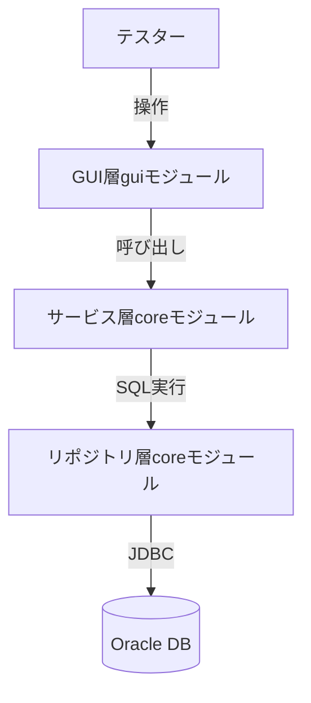

# 機能設計書

## システム構成図



## モジュール構成

| モジュール | パッケージ | 役割 |
|-----------|-----------|------|
| core | org.crudtest.core | ビジネスロジック・DB アクセス |
| gui | org.crudtest.gui | Swing GUI・イベント処理 |

---

## 機能ごとのアーキテクチャ

### 1. トリガー作成（Create）

**処理フロー**

```
[GUI: Createボタン] → CrudTestService#create(tableName)
  → ログシーケンス/ログテーブル/管理テーブル を未存在なら作成
  → 対象テーブルのメタデータ取得 (OracleMetaDataCreator)
  → トリガーDDL生成 (OracleTriggerCreator)
  → トリガー実行・管理テーブルへ登録
```

**生成される DB オブジェクト**

| オブジェクト | 用途 |
|-------------|------|
| ログテーブル（`CT_LOG`） | INSERT/UPDATE/DELETE 変更履歴を格納 |
| シーケンス（`CT_LOG_SEQ`） | ログテーブルの ID 採番 |
| 管理テーブル（`CT_MNG`） | 作成済みトリガー名を管理 |
| トリガー（`CT_TRG_{テーブル名}`） | 対象テーブルの変更を検知してログへ記録 |

---

### 2. ログ取得・Excel 出力（Print）

**処理フロー**

```
[GUI: Printボタン] → ExcelPrintService#printMultiTable(tableList, filePath)
  → テーブルごとにログレコードを SELECT
  → UPDATE は OLD/NEW ペアにマージ
  → DataConverter で LogRecoredBean に変換
  → Apache POI でシートへ書き込み
  → .xlsx ファイルを出力
```

**Excel レイアウト**

```
行1    : テーブル名
行2    : CRUD種別ヘッダ（INSERT / UPDATE / DELETE）
行3    : 変更前後区別ヘッダ（OLD / NEW）
行4以降: カラム名（列A） | 変更値（列B以降）
```

- UPDATE の OLD と NEW を隣列に並べ、変更があったセルを黄色ハイライト
- INSERT / DELETE 行も黄色ハイライト
- NULL 値は `<NULL>` と赤字表示

---

### 3. ログ削除（Delete Log）

```
[GUI: Delete Logボタン] → CrudTestService#deleteLogsTable(tableName)
  → ログテーブルから指定テーブルのレコードを DELETE
```

---

### 4. オブジェクト削除（Drop）

```
[GUI: Dropボタン] → CrudTestService#dropAllTrigger() → CrudTestService#dropObject()
  → 管理テーブルから全トリガー名を取得して DROP TRIGGER
  → 管理テーブルを TRUNCATE
  → ログシーケンス / ログテーブル / 管理テーブルを DROP
```

---

## データモデル定義

### ログテーブル（CT_LOG）

| カラム名 | 型 | 概要 |
|---------|-----|------|
| ID | CHAR(17) PK | タイムスタンプ＋シーケンスで生成した一意ID |
| TABLE_NAME | VARCHAR2(256) | 変更が発生したテーブル名 |
| CRUD_TYPE | VARCHAR2(10) | INSERT / UPDATE / DELETE |
| HISTORY_TYPE | VARCHAR2(3) | OLD / NEW（UPDATE の前後を区別） |
| DATA | CLOB | 変更前後の全カラム値|
| INSERT_DATE | DATE | ログ記録日時 |
| RECODE_TYPE | CHAR(1) | レコード種別 |
| ERROR_INFO | VARCHAR2(4000) | エラー情報 |
| REFELENCE_ID | CHAR(17) | UPDATE の OLD/NEW を紐付けるID |

**インデックス**

- `CT_LOG_IND` : REFELENCE_ID（UPDATE の OLD/NEW ペア検索用）

---

### 管理テーブル（CT_MNG）

| カラム名 | 型 | 概要 |
|---------|-----|------|
| ID | CHAR(17) PK | 一意ID |
| TRIGGER_NAME | VARCHAR2(256) | 作成済みトリガー名 |
| INSERT_DATE | DATE | 登録日時 |
| UPDATE_DATE | DATE | 更新日時 |
| DELETE_FLAG | CHAR(1) | 論理削除フラグ |

---

## コンポーネント設計

### core モジュール

```
org.crudtest.core
├── service
│   ├── CrudTestService         トリガー作成・削除・ログ削除の主要サービス
│   ├── ExcelPrintService       Excel 出力サービス
│   ├── bean
│   │   ├── LogRecoredBean      Excel 出力用の変換済みレコード
│   │   └── MetaTableInfo       テーブルメタデータ（カラム情報・PK情報）
│   └── logic
│       ├── DDL                 DDL 文字列の生成
│       ├── DataConverter       LogTable → LogRecoredBean 変換
│       ├── OracleMetaDataCreator  JDBC メタデータからテーブル情報を生成
│       └── OracleTriggerCreator   トリガー DDL 生成
├── repository
│   ├── OracleRepository        SQL 実行・結果取得
│   ├── DataBaseAssessor        メタデータ解析
│   ├── SqlLiterals             SQL 定数
│   ├── entity
│   │   └── LogTable            ログテーブルエンティティ
│   └── connection
│       ├── ConnectionFactory   接続ファクトリ interface
│       └── OracleConnectionFactory  Oracle JDBC 接続実装
├── poi
│   ├── WorkBookWrapper         Apache POI ワークブック操作ラッパー
│   └── CellWrapper             Apache POI セル操作ラッパー
├── properties
│   ├── ApplicationProperties   設定値 enum（テーブル名等）
│   └── ApplicationPropertiesReader  .propert ファイル読み込み
├── exception
│   ├── CrudTestException       基底例外
│   ├── JdbcException           DB 操作例外
│   └── FileIOException         ファイル I/O 例外
├── log
│   └── AppLogger               ロガーラッパー
└── util
    ├── DateUtil                日時ユーティリティ
    └── IOUtil                  I/O ユーティリティ
```

### gui モジュール

```
org.crudtest.gui
├── Start                       エントリポイント（main）
├── GuiProcess                  GUI 初期化・コンポーネント配置
├── CoreHelper                  core モジュール呼び出しラッパー
├── AssociateEvent              イベントとリスナーの紐付け
├── CompornentName              コンポーネント識別 enum
├── LocateCompornent            レイアウト制約定義
├── frame
│   ├── CrudTestFrame           メインフレーム（Swing Frame 管理）
│   ├── CreateTriggerDialog     トリガー作成ダイアログ
│   ├── DeleteAllObjectDialog   全オブジェクト削除確認ダイアログ
│   ├── DeleteLogDialog         ログ削除ダイアログ
│   └── LayoutHelper            GridBagConstraints ヘルパー
└── listener
    ├── MyWindowListener        ウィンドウクローズリスナー
    └── OutPutHtmlListener      出力リスナー
```

---

## 画面構成

### メイン画面（CrudTestFrame）

```
┌─────────────────────────────────┐
│          CRUD TEST              │
├─────────────────────────────────┤
│  監視テーブル一覧                │
│  ┌───────────────────────────┐  │
│  │ TABLE_A                   │  │
│  │ TABLE_B                   │  │
│  └───────────────────────────┘  │
│                                 │
│  [Create] [Print] [Drop] [Delete Log] │
└─────────────────────────────────┘
```

### トリガー作成ダイアログ（CreateTriggerDialog）

```
┌─────────────────────────────────┐
│  テーブル名を入力（改行で複数可） │
│  ┌───────────────────────────┐  │
│  │                           │  │
│  └───────────────────────────┘  │
│                  [OK] [Cancel]  │
└─────────────────────────────────┘
```
